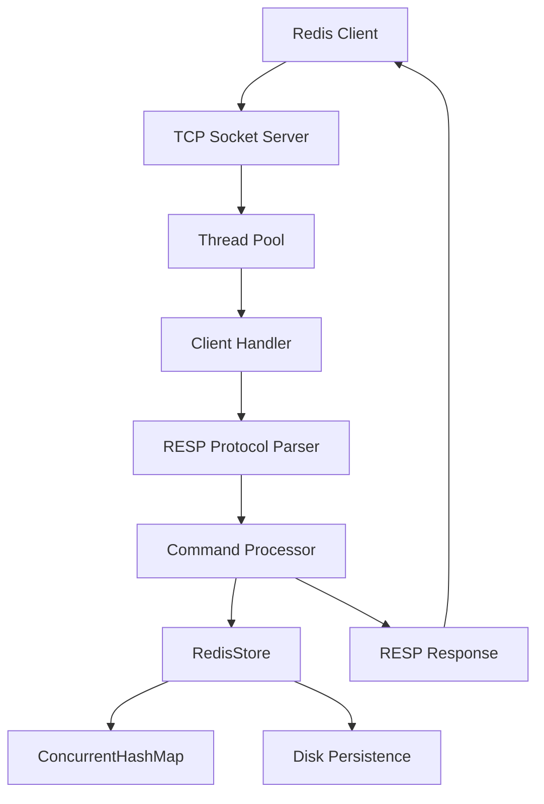

# RedisLite — System Architecture

## Overview

RedisLite is a lightweight, Redis-inspired key-value server built using Core Java.

It accepts client connections over TCP, processes commands using the RESP protocol, and stores data in a thread-safe in-memory data structure with disk persistence.

## Architecture Diagram

## Main Components

1. **TCP Server:** Accepts client connections on port 6379.
2. **Thread Pool:** Handles multiple clients concurrently.
3. **RESP Protocol:** Parses incoming commands and formats responses.
4. **Command Processor:** Executes PING, SET, GET, DEL and TTL.
5. **RedisStore:** Manages key-value data and expiration.
6. **ConcurrentHashMap:** Provides thread-safe in-memory storage.
7. **Disk Persistence:** Saves data and restores it after restart.

## Technology Stack

- Java 21
- Maven
- TCP Sockets
- RESP Protocol
- ConcurrentHashMap
- JUnit 5

## Data Flow

1. A client sends a command through a TCP connection.
2. The server assigns the connection to a worker thread.
3. The RESP parser reads and interprets the command.
4. The command processor calls the RedisStore.
5. The store performs the requested operation.
6. The server sends the response using RESP.
